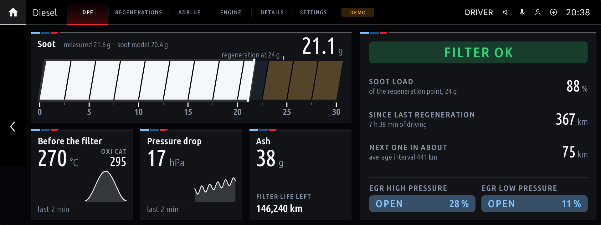
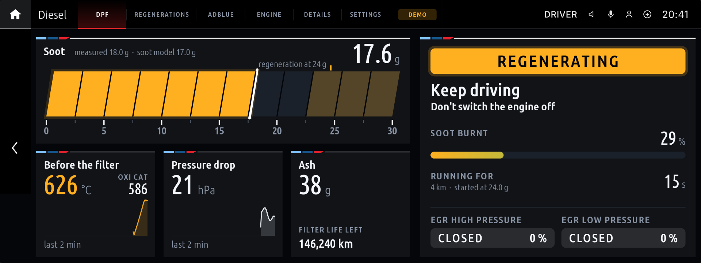
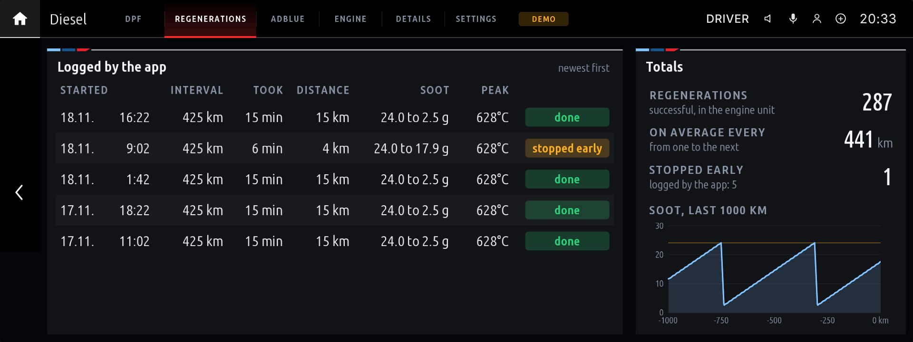
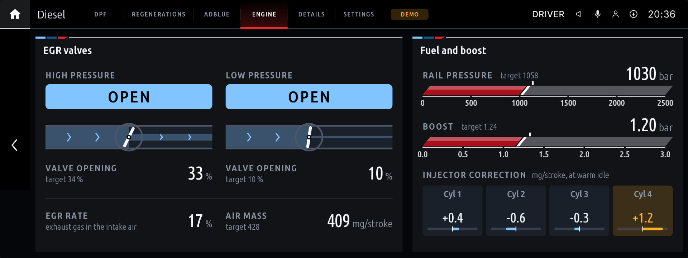

# BMW apps

Apps for the BMW MGU head unit (iDrive 7 and iDrive 8), installed through the
[MGU Store](https://github.com/robertnisipeanu/mgu-store). They run on the app runtime and GPU renderer of
[cauliflowermossgrape/idrive7-apps](https://github.com/cauliflowermossgrape/idrive7-apps), whose kit this repository
keeps a copy of, without its apps.

> **Disclaimer.** An unofficial hobby project, not affiliated with or endorsed by BMW AG. You modify your own head unit
> at your own risk. Use the apps parked or on a closed track.

## Apps

| App | |
|---|---|
| [**Diesel**](apps/hr_diesel/README.md) (`hr_diesel`) | For B47 / B57 diesels: the particulate filter's soot against the regeneration point, a log of regenerations kept in the background, a confirmed regeneration request, AdBlue, the EGR valves and the injector corrections. English, Simplified and Traditional Chinese, Korean. |

<table>
<tr>
<td width="50%"> <b>Diesel</b>: soot against the regeneration point, heat, pressure drop, ash, the EGR valves</td>
<td width="50%"> <b>Diesel</b>: a regeneration running</td>
</tr>
<tr>
<td> <b>Diesel</b>: each regeneration logged, and the soot over the last 1,000 km</td>
<td> <b>Diesel</b>: EGR valves, rail pressure and boost, injector corrections</td>
</tr>
</table>

## Install

1. Install the [MGU Store](https://github.com/robertnisipeanu/mgu-store) on the head unit.
2. Keep `cauliflowermossgrape/idrive7-apps` as a source (it is one by default): the apps here need its GPU renderer
   (`idrive7-renderd`) and controller gate (`mgu-inputgate`), and the Store installs them from it.
3. Add `Hubert-Rybak/bmw-apps` as a source, on branch `main`, and install the apps from it. The head unit builds
   each app from source, with the SDK of its own BMW apps.

## Develop

- `python3 kit/tools/build.py hr_diesel` builds `dist/hr_diesel@<version>.tgz` and `.mgu`. It needs `oap-sdk/`,
  extracted from your own head unit with `kit/tools/extract_sdk.js` (never commit it). Without it,
  `--preview-only` stages an offline preview; `--language ko|zh-CN|zh-TW` builds a fixed-language package.
- `node kit/tools/emu.js hr_diesel` runs an app in the browser emulator (also with `oap-sdk/` in place).
- `node tests/test_hr_diesel.js` runs an app's checks with no car or SDK. CI runs them on Node 8.9.4 and 8.16.2, the
  head units' versions.

### A new app

A folder `apps/hr_<name>/` with `app.json` (its `id` the folder's name, a `loggingId` of its own: the apps here use
`OAF0` upward, clear of upstream's `OA93`-`OAA5`), `main.js` and `icon.png`. The `apps/*` entry in `mgu-repo.json`
picks it up, so nothing else changes. Use the `hr_` prefix: app ids are global on the head unit.

Translations go in `kit/runtime/locales/<language>.tsv`, then `python3 kit/tools/sync_locales.py` writes the JSON and
`python3 kit/tools/bake_cjk.py` (Chinese: `--language zh-TW` too) or `bake_korean.py` re-bakes the glyph atlases.

## The kit and upstream

`kit/` (except `kit/icons`) is a copy of idrive7-apps at the commit in [`kit/UPSTREAM`](kit/UPSTREAM). Its paths are
listed in [`tools/kit-paths.txt`](tools/kit-paths.txt). The branch `upstream-kit` holds that copy exactly as upstream
has it, one commit per update; `main` merges it, so changes made here to the kit (the apps' translations and their
glyphs) carry over.

To update:

1. `tools/sync-kit.sh [upstream ref]` (default `main`) commits the new copy to `upstream-kit`.
2. On a branch off `main`, `tools/merge-kit.sh` merges it. Translation rows from both sides are kept
   (`.gitattributes` `merge=union`); the locale JSON is made again from them, and a language's glyph atlas is re-baked
   when both sides changed its texts (Pillow; Korean also needs Noto Sans CJK, `fonts-noto-cjk` on Debian/Ubuntu).
   Any other conflict is listed for you.
3. Push the branch and `upstream-kit`, and merge the pull request once the tests pass.

The **Kit sync** workflow does this every Monday, and needs you only when something is wrong:

- upstream's kit unchanged: nothing happens;
- the merge settles on its own and the tests pass on it: it goes straight into `main`;
- a conflict the script can't settle, or failing tests: a pull request `Kit: upstream idrive7-apps <commit>`
  waits for you. Once it's merged, the next run carries on as usual.

Opening that pull request needs *Settings > Actions > General > Allow GitHub Actions to create and approve pull
requests*. Run it by hand from Actions > Kit sync > Run workflow (optionally with an upstream commit or tag).

## Licence

The kit is idrive7-apps' (MIT): its notice is in [`LICENSE.MIT`](LICENSE.MIT) and ships in every app package
(`kit/runtime/LICENSE.MIT`).
